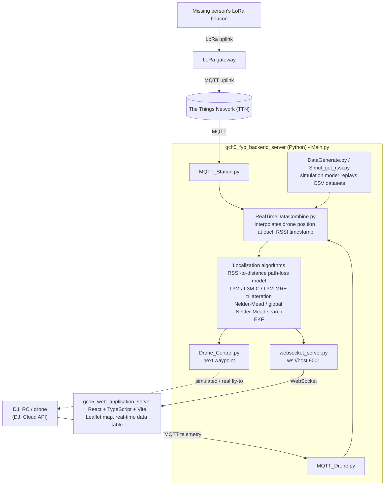
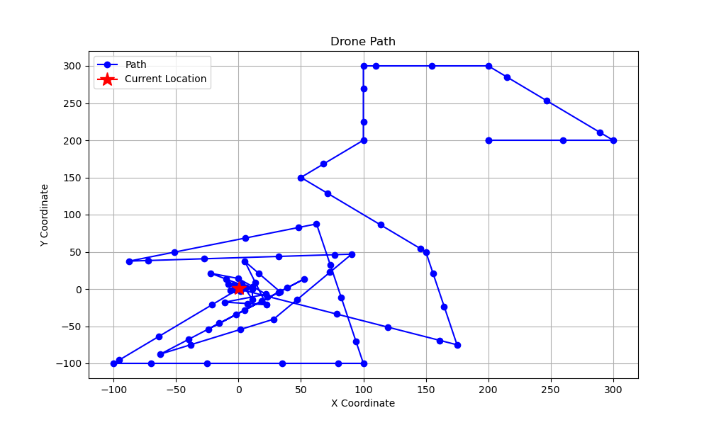

# Drone and IoT-Based Search for Missing People

A HKUST final-year project that locates a missing person's LoRa beacon by fusing IoT ground-station and drone RSSI readings, running them through several localization algorithms, and streaming the result to a live web map.

## Problem

Searching for a missing person on foot or by conventional means is slow, and the person being searched for often cannot be tracked directly (no phone GPS, no network coverage). This project investigates whether a low-power LoRa beacon carried by the person, combined with a search drone and fixed ground stations, can narrow down their location well enough to guide a real search. Rather than relying on GPS from the missing person's side, the system estimates position purely from the received signal strength (RSSI) of the beacon as seen by LoRa ground stations (via The Things Network) and by the drone as it moves — then uses that estimate to steer the drone toward the strongest signal.

## System architecture



The backend (`gch5_fyp_backend_server/python-scripts/Main.py`) runs in one of two modes, chosen at startup: **data** mode subscribes to the real TTN and DJI Cloud API MQTT feeds, while **simulation** mode replays recorded/simulated CSV datasets through the same pipeline so the algorithms can be tested without hardware. Either way, drone position and station RSSI are fused, run through a localization algorithm to estimate the tag's position and the drone's next move, and pushed to the web app over a plain WebSocket.

## Components

| Folder | Role | Tech stack |
| --- | --- | --- |
| `gch5_fyp_backend_server` | Core backend: ingests MQTT data from TTN and the DJI drone, fuses drone position with RSSI readings, runs the localization/search algorithms, and serves results over a WebSocket. Also contains an earlier Node.js/Flask relay (`server.js`, `server.py`) and an unused Node scaffold (`src/`) that were superseded by the current `Main.py` pipeline. | Python (paho-mqtt, websocket-server, NumPy, pandas, SciPy, scikit-learn, Matplotlib); legacy Node.js (Express, Socket.IO) / Flask |
| `gch5_web_application_server` | Main web app: Dashboard, Map & Route (live Leaflet map with drone position and predicted-location path), Camera View (placeholder panel, not yet implemented), and a Real-Time Data table — all driven by the backend's WebSocket feed. | React 18, TypeScript, Vite, MUI, Leaflet |
| `Localization_Algorithm` | Development versions of the L3M trilateration family (`l3m`, `l3m_c`, `l3m_mre`, `l3m_w`) and a k-means/SVD clustering variant, iterated on before the versions used in the backend's `Algorithm/` module. | Python, NumPy, pandas, scikit-learn, SciPy |
| `RSSI_2_Distance` | Fits the log-distance path-loss model (RSSI ↔ distance) by linear regression and plots the fitted curve against sample data. | Python, NumPy, SciPy, Matplotlib |
| `Distance_Predict` | Math notes (`math_note.tex`) deriving three-point and least-squares trilateration, plus a script (`points2distance.py`) implementing both directly. | LaTeX, Python |
| `EKF` | Exploratory Extended Kalman Filter localization, including a simulation comparing EKF against MLE, L3M, and MRE position estimates. | Python, NumPy, Matplotlib |
| `MQTT_Recieve` | Early standalone scripts for subscribing to the TTN application over MQTT — precursors to the backend's `MQTT_Station.py`. | Python, paho-mqtt |
| `Openaigym` | Reinforcement-learning exploration of learned search policies (Q-learning, DDQN/DDPG, SAC, and an LSTM+SAC+residual-network composite) against a custom drone/RSSI Gym environment. See "Reinforcement-learning exploration" below. | Python, Gymnasium/Gym, Stable-Baselines3, PyTorch |
| `DJI_RC_Login_app` | Minimal example of the DJI Cloud API login flow: a FastAPI endpoint serves a login page that registers the DJI RC with a local MQTT broker. | Python (FastAPI, uvicorn), HTML/JS |
| `map_testing` | Standalone Vite/React sandbox used to prototype the Leaflet map component in isolation from the main web app. | React, TypeScript, Vite |
| `webSocket_Testing_Client` | Standalone Vite/React sandbox used to test the WebSocket data feed in isolation. | React, TypeScript, Vite |

A handful of loose files at the repository root — `drone_path.png`, `station_data.json`, `mtrec-04_live_data_1712909531396.json`, `testing.py`, `Git test.py` — are early scratch scripts and captured sample data from initial MQTT experiments; they sit outside the running pipeline described above.

## Localization pipeline

- **Path-loss model** — `RSSI(d) = Z₀ − 10·n·log₁₀(d)`, where `Z₀` is the signal strength at 1 m and `n` is the environment's path-loss exponent. `RSSI_2_Distance/rssi_2_distance.py` and `data_compute_parameters.py` fit `n` and `Z₀` from sample (distance, RSSI) pairs by linear regression on log-distance, then invert the formula to turn a live RSSI reading into an estimated distance.
- **Trilateration (L3M family)** — `gch5_fyp_backend_server/python-scripts/Algorithm/path_loss_algorithm.py` (developed in `Localization_Algorithm/`) converts each RSSI sample, plus the drone's (x, y) position at that moment, into a distance estimate, then solves the linearized least-squares trilateration system for the tag's position — the same "subtract pairs of circle equations" derivation worked out in `Distance_Predict/math_note.tex` and implemented directly in `Distance_Predict/points2distance.py`. `L3M-C` reruns this over combinations of anchor points and keeps the tightest k-means cluster of the resulting estimates; `L3M-MRE` instead scores each combination by how well it reconstructs the observed RSSI values and keeps the best-scoring estimate, optionally dropping the worst anchor.
- **Search strategy (Nelder-Mead)** — `Algorithm/nelder_mead.py` treats the RSSI reading at the drone's current position as a black-box objective function and runs a derivative-free Nelder-Mead simplex search to fly the drone toward the strongest signal. `nelder_mead_global.py` adds a restart step that re-centers the simplex on a density-weighted centroid of previously visited points once progress stalls, to reduce the chance of settling on a local maximum.
- **Sensor fusion** — drone GPS and station RSSI arrive as two independent, unsynchronized streams, so `Data_handle/RealTimeDataCombine.py` linearly interpolates the drone's lat/lon at each RSSI timestamp, and `Coordinate_transfer.py` converts between lat/lon and a local planar (x, y) frame for the algorithms above.
- **EKF** — `EKF/` implements an Extended Kalman Filter formulation of the same problem (state = tag position, measurement = RSSI itself, linearized via a Jacobian of the path-loss model) and benchmarks it in simulation against MLE, L3M, and MRE in `EKF/ekf_localization_efficientcy.py`; it runs as a standalone simulation rather than inside `Main.py`.

`drone_path.png` (generated by `Process/path_draw.py`) shows a recorded example of a Nelder-Mead search: the drone's path (blue) starts far from the target and converges near the origin, the coordinate convention the code uses for the strongest-signal location.



## Reinforcement learning

Alongside the hand-designed search algorithms, `Openaigym/` trains learned policies to steer the drone. `env/map_esu.py` defines a custom Gymnasium environment (`DroneRSSIEnv`) where the state is a short history of the drone's relative movement and RSSI reading, the action is a 2D movement step, and the reward combines RSSI improvement with a bonus for reaching the strongest-signal location (found by interpolating a recorded RSSI dataset). `training/` trains several agents against this environment — Q-learning and DDQN/DDPG directly, and SAC (Soft Actor-Critic) via Stable-Baselines3 — and `lstm&sac/` sketches a further composite model: an LSTM (`lstm.py`) encodes a sequence of RSSI observations into a hidden state, which feeds both a SAC policy (`sac.py` / `sac_class.py`) choosing the next move and a residual network predicting the tag's (x, y) position, trained jointly in `lstm&sac/main.py`.

## Running it

### Backend — `gch5_fyp_backend_server`

```bash
cd gch5_fyp_backend_server/python-scripts
python Main.py
```

`requirements.txt` (one level up) is a full Conda environment export (UTF-16 encoded, roughly 300 entries covering the original developer's whole environment) rather than a curated dependency list. The packages the backend actually imports are `paho-mqtt`, `websocket-server`, `numpy`, `pandas`, `scipy`, `scikit-learn`, and `matplotlib`; install those directly, or trim `requirements.txt` first. Add `gymnasium`, `stable-baselines3`, and `torch` only if you also want to run the `Openaigym` experiments.

Credentials are never stored in the repository. Real-time mode reads the TTN MQTT login from the environment variables `TTN_MQTT_USERNAME` and `TTN_MQTT_PASSWORD` (`TTN_APP_ID` / `TTN_ACCESS_KEY` for the legacy `MQTT_Recieve/ttn_connect.py`), and the DJI Cloud API app id, key and license in `DJI_RC_Login_app/login.html` must be filled in with your own.

`Main.py` then prompts for a mode:

- **`data`** — real-time mode. Subscribes to the project's TTN application (`MQTT_Station.py`) and, if enabled, a DJI drone over the DJI Cloud API (`MQTT_Drone.py`); fuses the two streams and runs the selected localization algorithm live. Requires access to the original TTN application and/or a DJI RC on the same network.
- **`simulation`** — replays `compiled_data.csv` / `simulated_rssi_dataset.csv` as a stand-in for live drone and RSSI feeds. You'll be asked for the tag's approximate (lon, lat), the drone's starting (x, y), a target device ID, and which algorithm to run (`nelder_mead`, `nelder_mead_global`, or `l3m`). This mode needs no hardware.

### Web app — `gch5_web_application_server`

```bash
cd gch5_web_application_server
npm install
npm run dev
```

Set the backend's address in `src/configuration.ts` (`publicIp`) first. The app serves on port 5173 and expects the backend's WebSocket server on `ws://<publicIp>:9001`.

### DJI RC login helper — `DJI_RC_Login_app`

```bash
cd DJI_RC_Login_app
pip install fastapi uvicorn
python login.py
```

Its `ReadMe.md` documents installing from a `requirements.txt`, which is not included in this folder; `fastapi` and `uvicorn` are the packages `login.py` actually imports. The server serves `login.html` at `/login`, which is opened from the DJI Pilot app's *Cloud Service → Other platforms* screen to register the DJI Cloud API bridge; see `ReadMe.md` for the full MQTT-broker (EMQX) setup this depends on.

## Team

This was a team project for the HKUST CSE Final Year Project (2023–24). Roles below are as reflected in the commit history.

- **Su Chen yi** (GitHub: [nathan215](https://github.com/nathan215)) — repository owner. Commits under both the "Su Chen yi" and "nathan215" identities account for essentially all of the core localization work (`Distance_Predict/`, `EKF/`, `Localization_Algorithm/`, `RSSI_2_Distance/`) and the majority of `gch5_fyp_backend_server/`.
- **Wu-Chiachun** — git history shows contributions to the backend's data-transmission and process modules (e.g. `websocket_server.py`, `MQTT_Drone.py`, `Real_Time_tag_predict.py`), all of `DJI_RC_Login_app/`, and most of `gch5_web_application_server/`.
- **cc5u** — one documentation commit to `gch5_web_application_server/README.md`.

## Status

Archived HKUST CSE Final Year Project (2023–24), not maintained. The repository holds the deployed search pipeline together with the research tracks developed alongside it.
